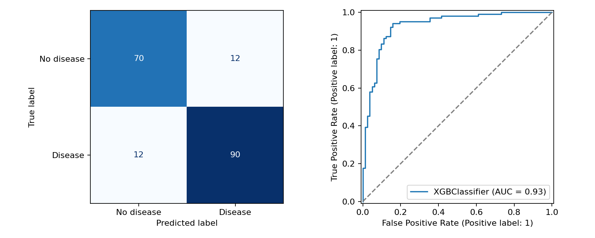

# Heart Disease Classification

**Dingyu Zhang · Waseda University, School of International Liberal Studies**

A reproducible revision of a course machine learning project comparing a majority
baseline, decision tree, random forest, XGBoost, and L1/L2 logistic regression on
918 records from a public heart disease dataset.

**Start with [the executed notebook](heart_disease_classification.ipynb).** It contains
the analysis, saved outputs, evaluation figures, and methodological limitations.

## Research question

How well can basic tabular models distinguish the dataset's `HeartDisease` labels,
and how do interpretable linear models compare with tree ensembles? The task is
classification of the supplied label, not prediction of future heart failure.

## Approach

- Retain 734 records for training and 184 for a stratified descriptive holdout.
- Treat zero cholesterol and resting blood pressure values as missing using a fixed rule.
- Learn median imputation, numeric scaling and category encoding inside each CV fold.
- Compare 12 candidate configurations with five-fold stratified training-only CV.
- Select by mean validation ROC-AUC; retain the default 0.5 decision threshold.
- Refit on training data, then evaluate the selected pipeline and majority baseline.
- Save metric tables, figures, data hash, software versions and run metadata.

## Recorded results

| Training CV candidate | Mean ROC-AUC | Fold SD |
| --- | ---: | ---: |
| XGBoost | 0.9319 | 0.0278 |
| Random forest, minimum leaf size 3 | 0.9316 | 0.0258 |
| L1 logistic regression, C = 1 | 0.9229 | 0.0344 |

The search selected XGBoost. Its small advantage over random forest does **not**
establish a meaningful performance difference. The full candidate table is in
[results/cv_results.csv](results/cv_results.csv).

| Historical holdout | Accuracy | Precision | Recall | F1 | ROC-AUC |
| --- | ---: | ---: | ---: | ---: | ---: |
| Majority baseline | 0.5543 | 0.5543 | 1.0000 | 0.7133 | 0.5000 |
| Selected XGBoost | 0.8696 | 0.8824 | 0.8824 | 0.8824 | 0.9315 |



**Evaluation caveat:** the original course analysis already inspected this seed-42
test partition. Reusing it preserves traceability but does not create a fresh,
independent test. The current implementation uses training-only CV for selection;
an external dataset is still needed to assess generalization. No old scores are
presented as results of the revised procedure.

## Run locally

Validated with Python 3.12. Core package versions are pinned in `requirements.txt`.
The terminal workflow and all notebook code cells were run successfully. Notebook
outputs were captured by sequential Python execution because the build environment
could not start a Jupyter kernel; interactive kernel execution was not verified here.
From a terminal in the repository folder:

```bash
python -m venv .venv
```

Activate the environment on Windows PowerShell:

```powershell
.venv\Scripts\Activate.ps1
```

Or on macOS/Linux:

```bash
source .venv/bin/activate
```

Then install dependencies and run:

```bash
python -m pip install -r requirements.txt
python download_data.py
python train.py
```

To explore interactively, run `python -m notebook` and open
`heart_disease_classification.ipynb` from the repository root. Restart the kernel
and run all cells. The script and notebook implement the same analysis. Rerunning
the script regenerates `results/` and `figures/`; the saved notebook outputs update
when the notebook is rerun and saved. No GPU is needed.

If automatic download fails, download version 1 manually from the dataset page
and place `heart.csv` in `data/`. The expected data SHA-256 is
`948420b084d8a3a0ca42b8419fce9aee175879e43f8aedf712377899a67aa49b`.
Minor numerical differences may occur across platforms or library versions.

## Files

| File | Purpose |
| --- | --- |
| `heart_disease_classification.ipynb` | Executed analysis with explanations and figures |
| `train.py` | Equivalent terminal workflow |
| `download_data.py` | Version-1 data download with manual fallback |
| `requirements.txt` | Environment dependencies |
| `results/` | CV table, holdout metrics, training summary, importance and metadata |
| `figures/` | Holdout diagnostics and training-set importance |
| `CHANGELOG.md` | Changes from the source course notebook |

## Limitations

The dataset merges historical sources, and patient/source identifiers are not
available for grouped validation. Exact duplicate checking cannot rule out patient
overlap. Results may reflect source-specific patterns. Median imputation is a
baseline assumption. Calibration, subgroup fairness and external performance were
not assessed. Training-set permutation importance is descriptive and can be
optimistic; it does not identify medical causes. This is an educational portfolio
project, not a clinically validated diagnostic tool.

## Data and acknowledgment

Dataset: [fedesoriano, Heart Failure Prediction Dataset, version 1](https://www.kaggle.com/datasets/fedesoriano/heart-failure-prediction).
The supplied target is `HeartDisease`. Consult the original page for source
provenance and reuse terms. Raw data are not redistributed here.

The original course notebook is by Dingyu Zhang. Its initial preprocessing approach
was informed by a classmate's approach and group discussion. This public revision
preserves the modeling scope while correcting preprocessing and evaluation;
ChatGPT assisted with code revision, documentation and execution checks. It should
not be interpreted as a wholly new independently developed study.

Software: [scikit-learn](https://scikit-learn.org/stable/),
[XGBoost](https://xgboost.readthedocs.io/), pandas, NumPy and Matplotlib.
No blanket license is assigned to third-party data or group-origin material.

## 日本語概要

公開データ918件を用い、心疾患ラベルの分類モデルを比較した授業プロジェクトです。
欠損値補完・標準化・カテゴリ変数の変換をPipelineに組み込み、訓練データ内の
5分割交差検証でモデルを選択しました。選択されたXGBoostの平均検証ROC-AUCは
0.9319でした。過去に確認済みのテストデータを再利用しているため、最終評価は
記述的な結果として扱い、外部データへの一般化や臨床的有効性は主張しません。
